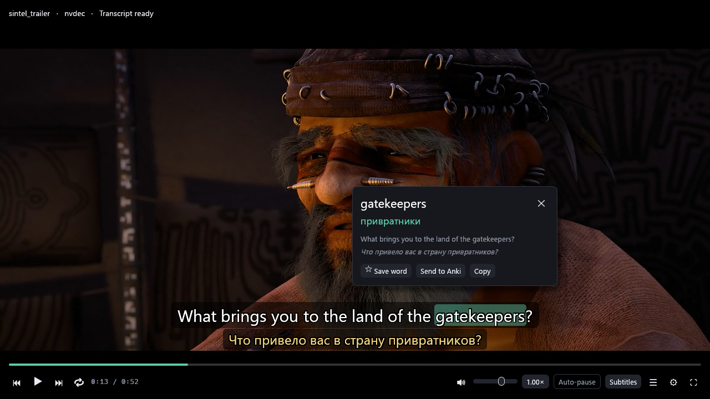
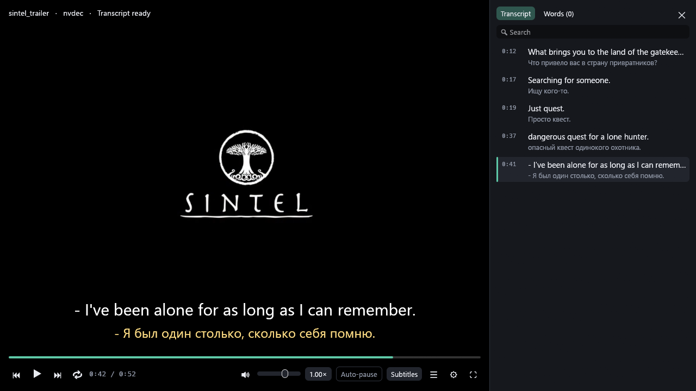

# Glossplay

**English** · [Русский](README.ru.md) · [Українська](README.uk.md) · [中文](README.zh.md)

A video player for people who learn languages by watching. It shows the original line and its
translation together, writes subtitles for videos that have none, explains any word you click,
and keeps the words you want to remember.



## What it does

- **Dual subtitles.** The original on top, the translation below. If the file has a track in
  your language, Glossplay uses it; if not, it translates the original as you watch, a little
  ahead of playback so the translation is already there when the line is spoken.
- **Subtitles from speech.** No subtitles at all? Whisper transcribes the audio locally. On a
  recent NVIDIA card an hour of video takes a couple of minutes, and the part you are watching is
  always done first.
- **Click a word.** Playback pauses and you get the translation, plus an explanation of the
  word *in this sentence* if you use an LLM for translation. Japanese and Chinese are split
  into words properly.
- **Your own word list.** Save a word with its sentence and the moment in the video. Send it
  to Anki with one click — the card gets a screenshot and an audio clip of the line.
- **Practice tools.** Auto-pause after every line, repeat the line, jump line by line, and a
  searchable transcript next to the video.
- **Plays nearly everything.** Playback is done by [mpv](https://mpv.io), so anything FFmpeg
  can open works: MKV, MP4, WebM, AVI, MOV, TS; H.264, HEVC, AV1, VP9 and the rest, with
  hardware decoding. Paste a link to an online video and it plays: Glossplay downloads yt-dlp by itself and keeps it up to date. On the first launch it fetches yt-dlp (about 23 MB) into its own data folder.



## Status

This is version 0.1, the first usable release.

| | |
|---|---|
| Windows 10/11 x64 | Built and tested by hand (NVIDIA GPU). |
| Linux, macOS | Compile and pass the test suite in CI. **Nobody has run the interface on them yet** — reports are welcome. |

Known limits of this version:

- Live transcription needs a GPU to keep up with playback. On a CPU, Whisper runs at roughly
  the speed of the video, so let it finish first.
- Transcription works for local files, not for online video.
- On Windows only NVIDIA cards decode without copying frames; other GPUs use hardware decoding
  with a copy (`d3d11va-copy`), which is fine up to 4K but uses more CPU.
- Image-based subtitles (Blu-ray PGS, DVD) are shown by mpv as pictures: no word lookup.
- Styled ASS subtitles are shown as plain text.
- The interface is in English.

## Install

### Windows

1. Download `glossplay-windows-x64.zip` from [Releases](../../releases) and unpack it.
2. Install FFmpeg — it is used to read subtitle tracks and audio:
   `winget install Gyan.FFmpeg`
3. Run `glossplay.exe`, drop a video on the window.

Optionally, turn on "Show Glossplay in Explorer's Open with and context menu" in Settings: it adds entries for the current user only and does not make Glossplay your default player. On Windows 11 the entry is under "Show more options".

### Linux and macOS

Build from source (below) and install mpv's library and FFmpeg:

```sh
# Debian / Ubuntu
sudo apt install libmpv2 ffmpeg
# macOS
brew install mpv ffmpeg
```

## Setting up the extras

Everything here is in **Settings** (the gear button). Nothing is required for plain dual
subtitles: translation works out of the box through Google Translate.

**Translation.** Pick a service:

| Service | Key | Notes |
|---|---|---|
| Google Translate | not needed | The default. Fast, literal. |
| DeepL | DeepL API key | Better wording for European languages. |
| OpenAI-compatible | depends | OpenAI, or a local model through Ollama / LM Studio (`http://localhost:11434/v1`). Explains words in context. |
| Claude | Anthropic API key | Translates with the surrounding dialogue in mind. Explains words in context. |

Privacy: with machine translation the subtitle text is sent to the service you chose. A local
model (Ollama / LM Studio) sends nothing to the internet, and speech recognition is always local.

The key is stored in `config.toml` in your user profile. The environment variable
`GLOSSPLAY_DEEPL_API_KEY`, `GLOSSPLAY_OPENAI_API_KEY` or `GLOSSPLAY_ANTHROPIC_API_KEY` (for the matching provider only) overrides it.

**Speech recognition.** Glossplay drives [whisper.cpp](https://github.com/ggml-org/whisper.cpp):

1. Download a build of whisper.cpp that contains `whisper-server`. The newest release often has
   no files, so open the [list of all releases](https://github.com/ggml-org/whisper.cpp/releases)
   and take the latest one that has files (Assets); its tag looks like `b5454`. For an NVIDIA
   card on Windows get `whisper-bin-win-cuda-12.4.0-x64.zip`; for other video cards or the
   CPU, `whisper-bin-x64.zip`. Without a video card, recognition runs at about the speed of the video.
2. Download a model, for example
   [`ggml-large-v3-turbo.bin`](https://huggingface.co/ggerganov/whisper.cpp/tree/main).
   Put [`ggml-silero-v5.1.2.bin`](https://huggingface.co/ggml-org/whisper-vad/tree/main) in the
   same folder — it stops Whisper from inventing text over silence and music.
3. Point Settings → Speech recognition at `whisper-server` and the model.
4. Use **Subtitles → Transcribe speech**, or tick "Transcribe automatically".

Transcripts are cached, so a video is only transcribed once.

**Anki.** Install the [AnkiConnect](https://ankiweb.net/shared/info/2055492159) add-on and keep
Anki running. The deck and the "Glossplay" note type are created on first use.

## Keys

| Key | Action |
|---|---|
| `Space` | Play / pause |
| `A` / `D` | Previous / next line |
| `S` | Repeat the current line |
| `P` | Auto-pause after every line |
| `←` / `→` | Back / forward 5 seconds |
| `↑` / `↓` | Volume |
| `[` / `]` | Slower / faster |
| `1` / `2` | Hide or show the original / the translation |
| `T` | Transcript and saved words |
| `F`, double click | Full screen |
| `M` | Mute |
| `Ctrl+O` | Open a file |
| `Esc` | Close the word card, leave full screen |

Subtitle files next to the video (`Movie.srt`, `Movie.en.srt`, `Movie.ru.ass`) are picked up
automatically. You can also drop a subtitle file on the window.

## Build from source

You need [Rust](https://rustup.rs) 1.95 or newer and a C compiler.

```sh
git clone https://github.com/Magerko/glossplay
cd glossplay
cargo build --release
```

The player loads mpv's library at run time, so nothing has to be linked:

- **Windows:** run `scripts/fetch-mpv.ps1` — it downloads `libmpv-2.dll` next to the built
  program. Or put the DLL from an [mpv dev build](https://github.com/shinchiro/mpv-winbuild-cmake/releases)
  there yourself.
- **Linux / macOS:** the system `libmpv` is found automatically.

Run the tests with `cargo test --workspace`. The player can also test itself on a real file:

```sh
glossplay --selftest video.mkv --subs en,ru --at 30
```

It plays for a few seconds, prints what it saw (frame size, decoder, dropped frames, the
subtitle lines on screen) and exits with a non-zero code if something is wrong.

## How it is built

Rust throughout, in five crates:

| Crate | What it holds |
|---|---|
| `gp-core` | Subtitle parsers (SRT, WebVTT, ASS), word segmentation, practice logic, config. No I/O. |
| `gp-store` | SQLite: translation cache, transcripts, saved words. |
| `gp-ai` | Translation services, the Whisper client, AnkiConnect. |
| `gp-media` | A small run-time binding to libmpv; FFmpeg and whisper-server as child processes. |
| `glossplay` | The application: an [egui](https://github.com/emilk/egui) interface that shares one OpenGL context with mpv. |

mpv renders each frame into a texture on the GPU and egui draws the subtitles on top, so every
word is a real interface element you can hover and click, and no frame is copied through the
CPU. Network requests, ffmpeg and speech recognition run on background threads, so playback never stalls while they work.

## Credits and licence

Glossplay is free software under the [GNU GPL v3](LICENSE) or later.

It stands on [mpv](https://mpv.io) and [FFmpeg](https://ffmpeg.org),
[whisper.cpp](https://github.com/ggml-org/whisper.cpp), [egui](https://github.com/emilk/egui),
[Lindera](https://github.com/lindera/lindera) and [jieba-rs](https://github.com/messense/jieba-rs).
The idea of a player built around language learning owes a lot to
[LLPlayer](https://github.com/umlx5h/LLPlayer).

The Windows release bundles `libmpv-2.dll` from
[shinchiro's mpv builds](https://github.com/shinchiro/mpv-winbuild-cmake) (GPL; the source is
available there).

Screenshots show the trailer of *Sintel* — © Blender Foundation, [durian.blender.org](https://durian.blender.org), CC BY 3.0.
