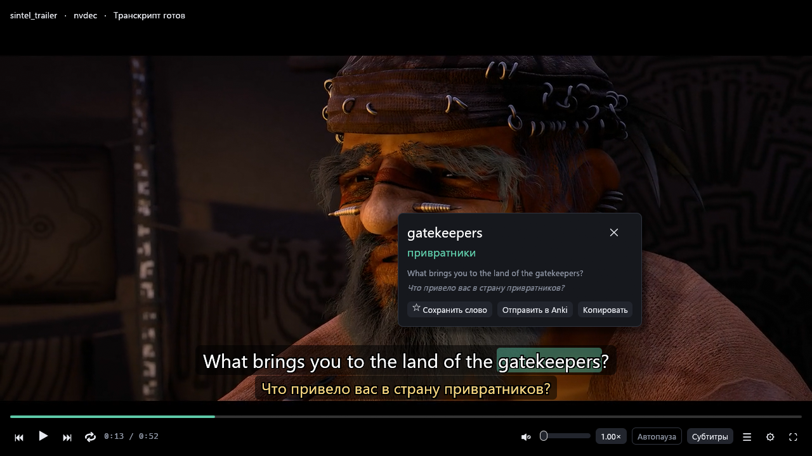
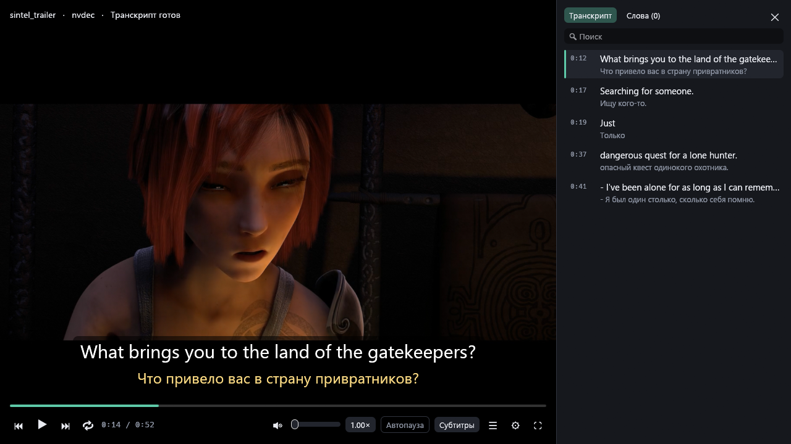

# Glossplay

[English](README.md) · **Русский** · [Українська](README.uk.md) · [中文](README.zh.md)

[](https://github.com/Magerko/glossplay/releases/latest)
[](https://github.com/Magerko/glossplay/releases)
[](https://github.com/Magerko/glossplay/actions/workflows/ci.yml)
[](LICENSE)
[](https://github.com/Magerko/glossplay/stargazers)


Видеоплеер для тех, кто учит языки по фильмам и роликам. Показывает реплику в оригинале вместе
с переводом, сам пишет субтитры к видео, у которых их нет, объясняет любое слово по клику
и хранит слова, которые вы хотите запомнить.



## Что умеет

- **Двойные субтитры.** Сверху оригинал, снизу перевод. Если в файле есть дорожка на вашем
  языке, берётся она; если нет — оригинал переводится по ходу просмотра, с опережением, так что
  перевод готов к моменту, когда реплика прозвучит.
- **Субтитры из речи.** Субтитров нет совсем? Whisper распознаёт речь прямо на вашем компьютере.
  Ставится одной кнопкой: плеер сам выбирает сборку под вашу видеокарту, скачивает её и модель.
  На современной видеокарте NVIDIA час видео обрабатывается примерно за пару минут, а место,
  которое вы смотрите, — в первую очередь. Без видеокарты NVIDIA распознавание работает на
  процессоре с моделью поменьше и медленнее: примерно со скоростью видео.
- **Клик по слову.** Воспроизведение встаёт на паузу, появляется перевод, а если для перевода
  выбрана языковая модель — ещё и объяснение слова *именно в этой фразе*. Японский и китайский
  текст корректно делится на слова.
- **Свой словарь.** Слово сохраняется вместе с фразой и моментом в видео. Одним нажатием оно
  уходит в Anki: в карточке будут кадр и аудиофрагмент реплики.
- **Тренировка.** Автопауза после каждой реплики, повтор реплики, переход по репликам
  и транскрипт с поиском рядом с видео.
- **Озвучка перевода.** Переведённые реплики можно произносить голосом поверх видео, приглушив
  оригинал; громкость оригинала и голоса регулируется отдельно. Движок озвучки (OmniVoice через
  audio.cpp) скачивается по кнопке. По умолчанию озвучка выключена, ей нужна видеокарта, и она
  только для некоммерческого использования (веса модели распространяются по лицензии CC BY-NC).
- **Открывает почти всё.** За воспроизведение отвечает [mpv](https://mpv.io), поэтому работает
  всё, что читает FFmpeg: MKV, MP4, WebM, AVI, MOV, TS; H.264, HEVC, AV1, VP9 и остальное,
  с аппаратным декодированием. Вставьте ссылку на видео из интернета — и оно воспроизводится: Glossplay сам скачивает yt-dlp и обновляет его. При первом запуске плеер скачивает yt-dlp (около 23 МБ) в свою папку данных.
- **Интерфейс** на английском, русском и украинском. Язык выбирается в настройках; по умолчанию
  берётся язык системы.
- **Свои источники.** Поиск через свой сервер поиска и просмотр через свой TorrServer.
  Источников в самом плеере нет.



## Состояние

Версия 0.1 — первый пригодный к работе выпуск.

| | |
|---|---|
| Windows 10/11 x64 | Собрано и проверено вручную, на Windows 11 с видеокартой NVIDIA. |
| Linux, macOS | Код собирается и проходит тесты в CI. **Интерфейс на них пока никто не запускал** — буду рад отзывам. Распознавание речи и озвучку там нужно настраивать вручную: установка одной кнопкой работает только в Windows. |

Ограничения этой версии:

- Без видеокарты распознавание речи может не успевать за воспроизведением; на процессоре лучше
  дать ему закончить заранее.
- Распознавание речи работает для локальных файлов и для потоков своего TorrServer; для видео
  по ссылке со страниц — нет.
- Озвучку пробовали только на видеокарте NVIDIA. Сборка Vulkan рассчитана на любую видеокарту,
  но на AMD и Intel не проверялась.
- Качество голоса зависит от модели; однословные реплики («Да.», «Нет.») могут звучать неровно.
- В Windows без копирования кадров декодируют только карты NVIDIA; на остальных используется
  аппаратное декодирование с копированием (`d3d11va-copy`) — до 4K этого хватает, но процессор
  нагружен сильнее.
- Графические субтитры (PGS с Blu-ray, DVD) mpv показывает картинкой: кликнуть по слову нельзя.
- Оформление ASS не воспроизводится — только текст.

## Установка

### Windows

1. Скачайте `glossplay-setup-x64.exe` со страницы [Releases](../../releases) и запустите. Он ставит программу для текущего пользователя и не требует прав администратора. Установщик не подписан цифровой подписью, поэтому Windows SmartScreen может предупредить о неизвестном издателе: нажмите «Подробнее», затем «Выполнить в любом случае».
   Либо скачайте `glossplay-windows-x64.zip` и распакуйте.
2. Установите FFmpeg — им читаются дорожки субтитров и звук:
   `winget install Gyan.FFmpeg`
3. Запустите `glossplay.exe` и перетащите видео в окно.

Для распознавания речи и озвучки нужен Microsoft Visual C++ Redistributable 2015–2022 (x64).
На большинстве компьютеров он уже есть. Если распознавание не запускается, установите его:
`winget install Microsoft.VCRedist.2015+.x64`

По желанию включите в настройках пункт «Показывать Glossplay в «Открыть с помощью» и контекстном меню проводника»: он добавляется только для текущего пользователя и не делает Glossplay программой по умолчанию. В Windows 11 пункт находится в «Показать дополнительные параметры».

### Linux и macOS

Соберите из исходников (см. ниже) и установите библиотеку mpv и FFmpeg:

```sh
# Debian / Ubuntu
sudo apt install libmpv2 ffmpeg
# macOS
brew install mpv ffmpeg
```

## Настройка дополнительных возможностей

Всё настраивается в **Settings** (кнопка с шестерёнкой). Для обычных двойных субтитров ничего
настраивать не нужно: перевод сразу работает через Google Translate.

**Перевод.** Выберите сервис:

| Сервис | Ключ | Примечание |
|---|---|---|
| Google Translate | не нужен | По умолчанию. Быстро, дословно. |
| DeepL | ключ DeepL API | Более естественные формулировки для европейских языков. |
| OpenAI-совместимый | по ситуации | OpenAI или локальная модель через Ollama / LM Studio (`http://localhost:11434/v1`). Объясняет слова в контексте. |
| Claude | ключ Anthropic API | Переводит с учётом соседних реплик. Объясняет слова в контексте. |

Приватность: при машинном переводе текст субтитров отправляется выбранному сервису. Локальная модель
(Ollama / LM Studio) ничего не отправляет в интернет, а распознавание речи всегда выполняется локально.

Ключ хранится в `config.toml` в профиле пользователя. Переменные окружения `GLOSSPLAY_DEEPL_API_KEY`, `GLOSSPLAY_OPENAI_API_KEY` и
`GLOSSPLAY_ANTHROPIC_API_KEY` (каждая только для своего провайдера) имеют приоритет над ним.

**Распознавание речи.** Выберите **Subtitles → Transcribe speech…** или **Settings → Speech
recognition → Install**. Glossplay определяет вашу видеокарту и скачивает
[whisper.cpp](https://github.com/ggml-org/whisper.cpp), модель Whisper и детектор голоса Silero
(он не даёт Whisper выдумывать текст на тишине и музыке):

| Ваш компьютер | Что устанавливается | Загрузка |
|---|---|---|
| Видеокарта NVIDIA, драйвер 525 или новее | сборка для NVIDIA, модель `large-v3-turbo` | около 2,3 ГБ |
| То же, но мало видеопамяти (меньше примерно 3,8 ГБ) | сборка для NVIDIA, модель `large-v3-turbo-q5_0` | около 1,3 ГБ |
| Нет видеокарты NVIDIA (или старый драйвер) | сборка для процессора, модель `small` | около 500 МБ |

Перед загрузкой окно показывает точный размер и позволяет самому выбрать сборку и модель
(`large-v3-turbo`, `large-v3-turbo-q5_0`, `small` или `base`). Прерванная загрузка продолжается
с того места, где остановилась. Без видеокарты NVIDIA распознавание медленнее — примерно со
скоростью видео, — поэтому дайте ему фору до просмотра. При первой транскрипции сборка для NVIDIA
может готовиться к вашей видеокарте до минуты (замечено на RTX 50-й серии). Запустите
**Subtitles → Transcribe speech** или включите «Transcribe automatically». Транскрипты
сохраняются, поэтому каждое видео распознаётся один раз.

*Для опытных: свой whisper.cpp.* В Settings → Speech recognition → Advanced можно указать
собственные `whisper-server` и файл модели. Нужна сборка whisper.cpp, в которой есть
`whisper-server`: у самого свежего релиза часто нет файлов, поэтому откройте
[страницу всех релизов](https://github.com/ggml-org/whisper.cpp/releases) и возьмите последний
релиз, у которого есть файлы (Assets); его тег выглядит как `b5454`. Для видеокарты NVIDIA в Windows —
`whisper-bin-win-cuda-12.4.0-x64.zip`, для остальных видеокарт и для процессора —
`whisper-bin-x64.zip`. Модели лежат на [Hugging Face](https://huggingface.co/ggerganov/whisper.cpp/tree/main);
[`ggml-silero-v5.1.2.bin`](https://huggingface.co/ggml-org/whisper-vad/tree/main) положите в ту же
папку, что и модель.

**Озвучка.** Включается в меню **Subtitles → Voice-over (dub the translation)** или в
Settings → Voice-over. Озвучивается перевод, поэтому перевод должен быть включён. В первый раз
Glossplay предложит скачать движок озвучки: audio.cpp (релиз v0.9.5) с GitHub и модель
OmniVoice (`omnivoice-q8_0`) с Hugging Face. Голос синтезируется на вашем компьютере, поэтому
ничего никуда не отправляется.

| Сборка | Загрузка |
|---|---|
| Vulkan — любая видеокарта (по умолчанию) | около 1,44 ГБ |
| NVIDIA (CUDA) — чуть быстрее, но намного больше | около 2,21 ГБ |

Нужна видеокарта: на одном процессоре голос в 6–10 раз медленнее видео и не успевает. Голос
говорит на языке, выбранном в «Translate into». В меню Subtitles два ползунка задают громкость
оригинала (по умолчанию 25%) и голоса (100%); первый запуск на видеокарте может занять до
полуминуты.

Условия использования, которые вы принимаете перед загрузкой:

- Только некоммерческое использование. Модель OmniVoice распространяется по лицензии CC BY-NC 4.0:
  ни саму модель, ни то, что она произносит, нельзя использовать в коммерческих целях.
- Не используйте движок озвучки, чтобы имитировать голос реального человека без его согласия.
- Built with Higgs Materials licensed from Boson AI USA, Inc. (аудио-токенизатор внутри модели,
  по лицензии Boson Higgs Audio 2 Community License).

*Для опытных: свой сервер озвучки.* Если у вас уже работает сервер с OpenAI-совместимым
`/v1/audio/speech`, укажите его адрес в Settings → Voice-over → Advanced. Он хранится в секции
`[tts]` файла `config.toml`: `base_url` (например, `http://host:port/v1`; пусто — установленный
движок), `model`, `voice` (пусто — голос сервера по умолчанию), `original_volume` и
`voice_volume` в процентах, `enabled` (по умолчанию выключено).

**Anki.** Установите дополнение [AnkiConnect](https://ankiweb.net/shared/info/2055492159) и держите
Anki запущенным. Колода и тип записи «Glossplay» создаются при первом экспорте.

**Свои источники.** Glossplay умеет искать по серверу поиска, который говорит по протоколу
Torznab ([Jackett](https://github.com/Jackett/Jackett), [Prowlarr](https://prowlarr.com)), и
воспроизводить результат через [TorrServer](https://github.com/YouROK/TorrServer), не дожидаясь
полной загрузки, — со всеми функциями плеера: двойные субтитры, перевод, клик по слову,
распознавание речи.

В Glossplay нет ни одного источника, и он ничего не рекомендует. Какие источники добавить в свой
сервер поиска и что через них смотреть — решает и за это отвечает пользователь; уважайте
авторские права и законы своей страны.

1. Установите и настройте сервер поиска и TorrServer. Если вы уже ими пользуетесь (например, с
   телевизионным приложением), ничего ставить не нужно.
2. В настройках плеера, в секции **Источники**, впишите адрес Torznab (для Jackett он выглядит
   так: `http://127.0.0.1:9117/api/v2.0/indexers/all/results/torznab/api`), ключ API и адрес
   TorrServer (вида `http://127.0.0.1:8090`). Нажмите **Проверить**.
3. После этого на стартовом экране появится поле поиска, а в плеере заработает **Ctrl+F**.

Введите запрос — получите список (название, размер, сиды, источник); двойной щелчок по строке —
смотреть. Если в раздаче несколько видеофайлов, нужно выбрать файл.

Ограничения: субтитры, встроенные в файл, из потока читаются только после полной загрузки файла
(файлы `.srt`, лежащие в раздаче рядом с видео, подхватываются сразу); TorrServer с паролем не
поддерживается; раздел поиска скрыт, пока не заполнены оба адреса. Настройки хранятся в секции
`[sources]` файла `config.toml` (`torznab_url`, `torznab_key`, `torrserver_url`); ключ
переопределяет переменная окружения `GLOSSPLAY_TORZNAB_KEY`.

## Клавиши

| Клавиша | Действие |
|---|---|
| `Пробел` | Воспроизведение / пауза |
| `A` / `D` | Предыдущая / следующая реплика |
| `S` | Повторить текущую реплику |
| `P` | Автопауза после каждой реплики |
| `←` / `→` | Назад / вперёд на 5 секунд |
| `↑` / `↓` | Громкость |
| `[` / `]` | Медленнее / быстрее |
| `1` / `2` | Скрыть или показать оригинал / перевод |
| `T` | Транскрипт и сохранённые слова |
| `F`, двойной щелчок | Полный экран |
| `M` | Без звука |
| `Ctrl+O` | Открыть файл |
| `Ctrl+F` | Поиск по своим источникам (показывается, когда источники настроены) |
| `Ctrl+V` | Открыть скопированную ссылку, magnet-ссылку или путь к файлу (когда курсор не в поле ввода) |
| `Esc` | Закрыть карточку слова, диалог или окно поиска, выйти из полного экрана |

Буквенные клавиши работают по своему месту на клавиатуре при любой раскладке: и в русской
`S` (там это «ы») повторяет реплику. Пока открыт диалог, действует только `Esc`; пока вы
печатаете в поле — только `Esc`, `Ctrl+O` и `Ctrl+F`. Magnet-ссылка открывается через
TorrServer, поэтому нужны настроенные источники.

Файлы субтитров рядом с видео (`Movie.srt`, `Movie.en.srt`, `Movie.ru.ass`) подхватываются
автоматически. Файл субтитров можно и просто перетащить в окно.

## Планы

Сроков не обещаю; это направление работы.

- Экспорт видео в файл с дорожками перевода, вшитыми одинарными или двойными субтитрами и дорожкой озвучки.
- Каталог фильмов и сериалов с постерами и описаниями поверх своих источников.
- Встроенный торрент-движок, чтобы не нужен был отдельный TorrServer.
- Ускорение распознавания речи на видеокартах AMD и Intel.
- Воспроизведение без копирования кадров на видеокартах AMD и Intel под Windows.
- Проверенные сборки и пакеты для Linux и macOS.
- Словари в формате Yomitan и словарные формы слов.
- Озвучка голосом оригинального актёра — только с согласия того, кому этот голос принадлежит.
- Китайский и другие языки интерфейса.
- Установщик для Windows и пункт в коротком контекстном меню Windows 11.

## Сборка из исходников

Нужны [Rust](https://rustup.rs) 1.95 или новее и компилятор C.

```sh
git clone https://github.com/Magerko/glossplay
cd glossplay
cargo build --release
```

Библиотека mpv загружается во время работы, линковать ничего не нужно:

- **Windows:** запустите `scripts/fetch-mpv.ps1` — он скачает `libmpv-2.dll` и положит рядом
  с собранной программой. Либо возьмите DLL из
  [dev-сборки mpv](https://github.com/shinchiro/mpv-winbuild-cmake/releases) сами.
- **Linux / macOS:** системная `libmpv` находится автоматически.

Чтобы собрать релиз для распространения в Windows, используйте `scripts/build-release.ps1`: он убирает из exe пути вашего компьютера (домашнюю папку, имя пользователя). Затем `scripts/package.ps1` упаковывает zip с `glossplay.exe`, `libmpv-2.dll` и файлами лицензий.

Тесты: `cargo test --workspace`. Плеер умеет проверять себя и на настоящем файле:

```sh
glossplay --selftest video.mkv --subs en,ru --at 30
```

Он проигрывает несколько секунд, печатает, что увидел (размер кадра, декодер, пропущенные кадры,
реплики на экране), и завершается с ненулевым кодом, если что-то не так. `glossplay --help`
перечисляет остальные параметры, в том числе `--install-asr`, `--install-tts` и `--asr-status`
для установки и проверки компонентов из командной строки.

## Как устроено

Весь код на Rust, пять крейтов:

| Крейт | Что внутри |
|---|---|
| `gp-core` | Парсеры субтитров (SRT, WebVTT, ASS), деление на слова, логика тренировки, настройки. Без ввода-вывода. |
| `gp-store` | SQLite: кэш переводов, транскрипты, сохранённые слова. |
| `gp-ai` | Сервисы перевода, клиент Whisper, клиент синтеза речи, AnkiConnect, клиенты Torznab и TorrServer. |
| `gp-media` | Небольшая привязка к libmpv, загружаемая во время работы; FFmpeg, whisper-server и движок озвучки как дочерние процессы. |
| `glossplay` | Приложение: интерфейс на [egui](https://github.com/emilk/egui) в одном OpenGL-контексте с mpv. |

mpv рисует каждый кадр в текстуру на видеокарте, а egui выводит поверх субтитры, поэтому каждое
слово — настоящий элемент интерфейса, на который можно навести курсор и нажать, и ни один кадр
не копируется через процессор. Сеть, ffmpeg, распознавание речи и озвучка работают в фоновых потоках, поэтому воспроизведение не замирает, пока они заняты.

## Благодарности и лицензия

Glossplay — свободная программа под лицензией [GNU GPL v3](LICENSE) или более поздней.

Она опирается на [mpv](https://mpv.io) и [FFmpeg](https://ffmpeg.org),
[whisper.cpp](https://github.com/ggml-org/whisper.cpp), [egui](https://github.com/emilk/egui),
[Lindera](https://github.com/lindera/lindera) и [jieba-rs](https://github.com/messense/jieba-rs).
Для озвучки используются [audio.cpp](https://github.com/0xShug0/audio.cpp) (Apache-2.0) и модель
[OmniVoice](https://github.com/k2-fsa/OmniVoice); модель в поставку не входит: вы скачиваете её
сами и на её собственных условиях (см. выше).
Идея плеера, построенного вокруг изучения языка, многим обязана
[LLPlayer](https://github.com/umlx5h/LLPlayer).

В выпуск для Windows входит `libmpv-2.dll` из
[сборок mpv от shinchiro](https://github.com/shinchiro/mpv-winbuild-cmake) (GPL; исходный код
доступен там же). В архиве также лежат `THIRD-PARTY.txt` и `THIRD-PARTY-RUST.txt` с версиями,
источниками и лицензиями всех сторонних компонентов.

На скриншотах — трейлер фильма *Sintel*, © Blender Foundation, [durian.blender.org](https://durian.blender.org), CC BY 3.0.
