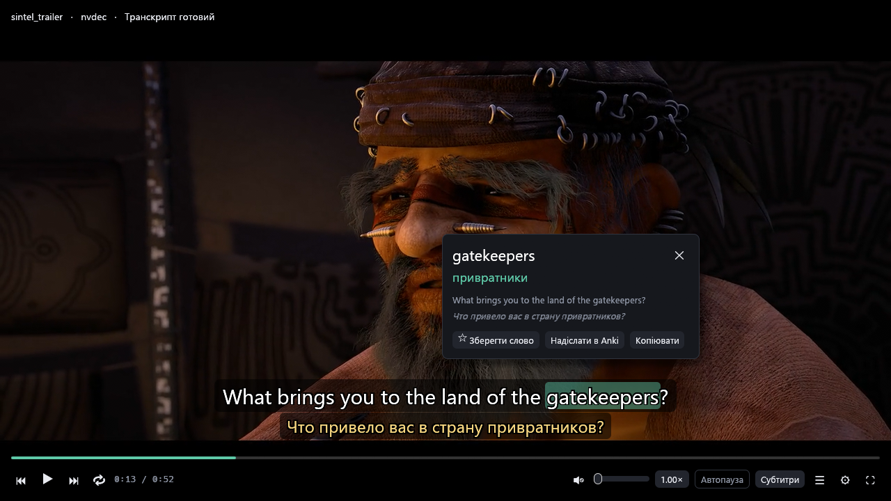
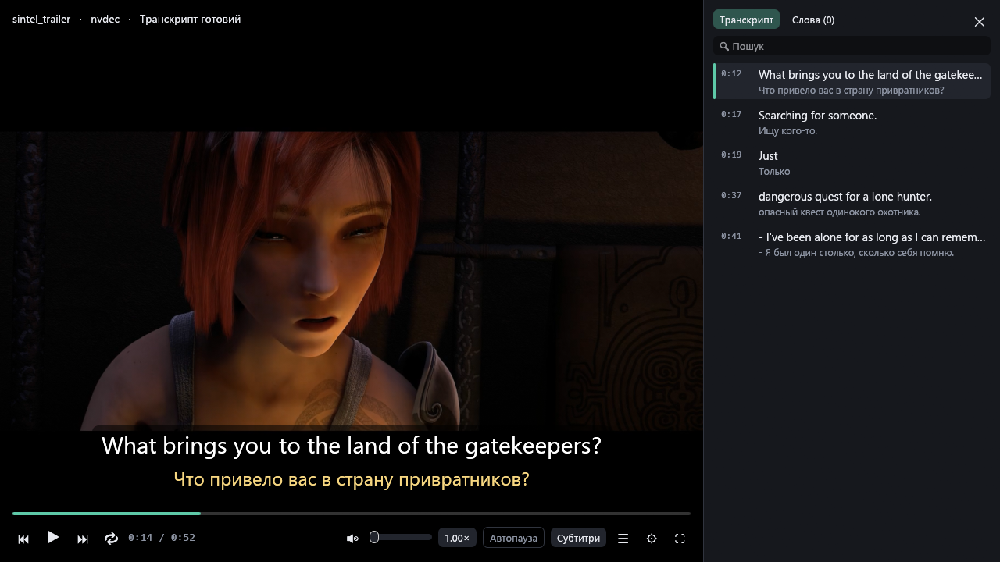

# Glossplay

[English](README.md) · [Русский](README.ru.md) · **Українська** · [中文](README.zh.md)

[](https://github.com/Magerko/glossplay/releases/latest)
[](https://github.com/Magerko/glossplay/releases)
[](https://github.com/Magerko/glossplay/actions/workflows/ci.yml)
[](LICENSE)
[](https://github.com/Magerko/glossplay/stargazers)


Відеоплеєр для тих, хто вивчає мови за фільмами та роликами. Показує репліку в оригіналі разом
із перекладом, сам створює субтитри до відео, у яких їх немає, пояснює будь-яке слово після
кліку й зберігає слова, які ви хочете запам'ятати.



## Що вміє

- **Подвійні субтитри.** Зверху оригінал, знизу переклад. Якщо у файлі є доріжка вашою мовою,
  береться вона; якщо немає — оригінал перекладається під час перегляду, з випередженням, тож
  переклад готовий до моменту, коли репліка прозвучить.
- **Субтитри з мовлення.** Субтитрів немає зовсім? Whisper розпізнає мовлення просто на вашому
  комп'ютері. Встановлюється однією кнопкою: плеєр сам обирає збірку під вашу відеокарту,
  завантажує її та модель. На сучасній відеокарті NVIDIA година відео обробляється приблизно за
  дві хвилини, а місце, яке ви дивитеся, — насамперед. Без відеокарти NVIDIA розпізнавання
  працює на процесорі з меншою моделлю й повільніше: приблизно зі швидкістю відео.
- **Клік по слову.** Відтворення стає на паузу, з'являється переклад, а якщо для перекладу
  обрано мовну модель — ще й пояснення слова *саме в цій фразі*. Японський і китайський текст
  коректно ділиться на слова.
- **Власний словник.** Слово зберігається разом із фразою та моментом у відео. Одним
  натисканням воно потрапляє до Anki: у картці будуть кадр і аудіофрагмент репліки.
- **Тренування.** Автопауза після кожної репліки, повтор репліки, перехід між репліками
  та транскрипт із пошуком поруч із відео.
- **Озвучення перекладу.** Перекладені репліки можна вимовляти голосом поверх відео, приглушивши
  оригінал; гучність оригіналу та голосу налаштовується окремо. Рушій озвучення (OmniVoice через
  audio.cpp) завантажується за кнопкою. Типово озвучення вимкнене, потребує відеокарти й
  призначене лише для некомерційного використання (ваги моделі поширюються за ліцензією CC BY-NC).
- **Відкриває майже все.** За відтворення відповідає [mpv](https://mpv.io), тому працює все,
  що читає FFmpeg: MKV, MP4, WebM, AVI, MOV, TS; H.264, HEVC, AV1, VP9 та решта, з апаратним
  декодуванням. Вставте посилання на відео з інтернету — і воно відтворюється: Glossplay сам завантажує yt-dlp і оновлює його. Під час першого запуску програвач завантажує yt-dlp (близько 23 МБ) у свою теку даних.
- **Інтерфейс** англійською, російською та українською. Мову обирають у налаштуваннях; типово
  береться мова системи.
- **Власні джерела.** Пошук через власний сервер пошуку й перегляд через власний TorrServer.
  Самих джерел у програвачі немає.



## Стан

Версія 0.1 — перший придатний до роботи випуск.

| | |
|---|---|
| Windows 10/11 x64 | Зібрано й перевірено вручну, на Windows 11 з відеокартою NVIDIA. |
| Linux, macOS | Код збирається та проходить тести в CI. **Інтерфейс на них поки ніхто не запускав** — буду вдячний за відгуки. Розпізнавання мовлення й озвучення там доведеться налаштовувати вручну: встановлення однією кнопкою працює лише у Windows. |

Обмеження цієї версії:

- Без відеокарти розпізнавання мовлення може не встигати за відтворенням; на процесорі краще
  дати йому закінчити заздалегідь.
- Автоматичні субтитри YouTube пропонуються лише мовою відео, мовою, яку ви вивчаєте, і рідною.
  У старих автосубтитрів немає розділових знаків, тому фрази діляться за паузами, і фраза
  іноді уривається посередині.
- Вбудовані текстові субтитри мережевого потоку (TorrServer, прямі посилання) з'являються в
  міру перегляду: переклад і список фраз заповнюються лише для вже програних місць.
- Розпізнавання мовлення працює для локальних файлів, для потоків власного TorrServer і для
  сайтів, де yt-dlp віддає окрему звукову доріжку по HTTP (наприклад YouTube). Потоки лише з
  HLS не підтримуються.
- Озвучення пробували лише на відеокарті NVIDIA. Збірка Vulkan розрахована на будь-яку
  відеокарту, але на AMD та Intel не перевірялась.
- Якість голосу залежить від моделі; однослівні репліки («Так.», «Ні.») можуть звучати нерівно.
- У Windows без копіювання кадрів декодують лише карти NVIDIA; на інших використовується
  апаратне декодування з копіюванням (`d3d11va-copy`) — до 4K цього достатньо, але процесор
  навантажений більше.
- Графічні субтитри (PGS із Blu-ray, DVD) mpv показує зображенням: клікнути по слову не можна.
- Оформлення ASS не відтворюється — лише текст.

## Встановлення

### Windows

1. Завантажте `glossplay-setup-x64.exe` зі сторінки [Releases](../../releases) і запустіть. Він встановлює програму для поточного користувача й не потребує прав адміністратора. Установник не підписаний цифровим підписом, тому Windows SmartScreen може попередити про невідомого видавця: натисніть «Докладніше», потім «Все одно виконати».
   Або завантажте `glossplay-windows-x64.zip` і розпакуйте.
2. Встановіть FFmpeg — ним читаються доріжки субтитрів і звук:
   `winget install Gyan.FFmpeg`
3. Запустіть `glossplay.exe` і перетягніть відео у вікно.

Для розпізнавання мовлення й озвучення потрібен Microsoft Visual C++ Redistributable 2015–2022 (x64).
На більшості комп'ютерів він уже є. Якщо розпізнавання не запускається, встановіть його:
`winget install Microsoft.VCRedist.2015+.x64`

За бажанням увімкніть у налаштуваннях пункт «Показувати Glossplay в «Відкрити за допомогою» та контекстному меню провідника»: він додається лише для поточного користувача і не робить Glossplay програмою за замовчуванням. У Windows 11 пункт розташований у «Показати додаткові параметри».

### Linux і macOS

Зберіть із вихідного коду (див. нижче) і встановіть бібліотеку mpv та FFmpeg:

```sh
# Debian / Ubuntu
sudo apt install libmpv2 ffmpeg
# macOS
brew install mpv ffmpeg
```

## Налаштування додаткових можливостей

Усе налаштовується в **Settings** (кнопка з шестернею). Для звичайних подвійних субтитрів нічого
налаштовувати не треба: переклад одразу працює через Google Translate.

**Переклад.** Оберіть сервіс:

| Сервіс | Ключ | Примітка |
|---|---|---|
| Google Translate | не потрібен | Типовий. Швидко, дослівно. |
| DeepL | ключ DeepL API | Природніші формулювання для європейських мов. |
| OpenAI-сумісний | залежно від сервера | OpenAI або локальна модель через Ollama / LM Studio (`http://localhost:11434/v1`). Пояснює слова в контексті. |
| Claude | ключ Anthropic API | Перекладає з урахуванням сусідніх реплік. Пояснює слова в контексті. |

Приватність: під час машинного перекладу текст субтитрів надсилається обраному сервісу. Локальна модель
(Ollama / LM Studio) нічого не надсилає в інтернет, а розпізнавання мовлення завжди відбувається локально.

Ключ зберігається в `config.toml` у профілі користувача. Змінні середовища `GLOSSPLAY_DEEPL_API_KEY`, `GLOSSPLAY_OPENAI_API_KEY` і
`GLOSSPLAY_ANTHROPIC_API_KEY` (кожна лише для свого провайдера) мають пріоритет над ним.

**Розпізнавання мовлення.** Оберіть **Subtitles → Transcribe speech…** або **Settings → Speech
recognition → Install**. Glossplay визначає вашу відеокарту й завантажує
[whisper.cpp](https://github.com/ggml-org/whisper.cpp), модель Whisper та детектор голосу Silero
(він не дає Whisper вигадувати текст на тиші та музиці):

| Ваш комп'ютер | Що встановлюється | Завантаження |
|---|---|---|
| Відеокарта NVIDIA, драйвер 525 або новіший | збірка для NVIDIA, модель `large-v3-turbo` | близько 2,3 ГБ |
| Те саме, але мало відеопам'яті (менше приблизно 3,8 ГБ) | збірка для NVIDIA, модель `large-v3-turbo-q5_0` | близько 1,3 ГБ |
| Немає відеокарти NVIDIA (або старий драйвер) | збірка для процесора, модель `small` | близько 500 МБ |

Перед завантаженням вікно показує точний розмір і дає змогу самому обрати збірку та модель
(`large-v3-turbo`, `large-v3-turbo-q5_0`, `small` або `base`). Перервене завантаження
продовжується з місця зупинки. Без відеокарти NVIDIA розпізнавання повільніше — приблизно зі
швидкістю відео, — тому дайте йому фору до перегляду. Під час першої транскрипції збірка для
NVIDIA може готуватися до вашої відеокарти до хвилини (помічено на RTX 50-ї серії). Запустіть
**Subtitles → Transcribe speech** або ввімкніть «Transcribe automatically». Транскрипти
зберігаються, тому кожне відео розпізнається один раз.

*Для досвідчених: власний whisper.cpp.* У Settings → Speech recognition → Advanced можна вказати
власні `whisper-server` і файл моделі. Потрібна збірка whisper.cpp, у якій є `whisper-server`:
у найсвіжішого релізу часто немає файлів, тому відкрийте
[сторінку всіх релізів](https://github.com/ggml-org/whisper.cpp/releases) і візьміть останній
реліз, у якого є файли (Assets); його тег виглядає як `b5454`. Для відеокарти NVIDIA у Windows —
`whisper-bin-win-cuda-12.4.0-x64.zip`, для інших відеокарт і для процесора —
`whisper-bin-x64.zip`. Моделі лежать на [Hugging Face](https://huggingface.co/ggerganov/whisper.cpp/tree/main);
[`ggml-silero-v5.1.2.bin`](https://huggingface.co/ggml-org/whisper-vad/tree/main) покладіть у ту
саму теку, що й модель.

**Озвучення.** Вмикається в меню **Subtitles → Voice-over (dub the translation)** або в
Settings → Voice-over. Озвучується переклад, тому переклад має бути ввімкнений. Уперше
Glossplay запропонує завантажити рушій озвучення: audio.cpp (реліз v0.9.5) з GitHub і модель
OmniVoice (`omnivoice-q8_0`) з Hugging Face. Голос синтезується на вашому комп'ютері, тож
нічого нікуди не надсилається.

| Збірка | Завантаження |
|---|---|
| Vulkan — будь-яка відеокарта (типово) | близько 1,44 ГБ |
| NVIDIA (CUDA) — трохи швидше, але набагато більша | близько 2,21 ГБ |

Потрібна відеокарта: лише на процесорі голос у 6–10 разів повільніший за відео й не встигає. Голос
говорить мовою, обраною в «Translate into». У меню Subtitles два повзунки задають гучність
оригіналу (типово 25%) і голосу (100%); перший запуск на відеокарті може тривати до пів хвилини.

Умови використання, які ви приймаєте перед завантаженням:

- Лише некомерційне використання. Модель OmniVoice поширюється за ліцензією CC BY-NC 4.0:
  ні саму модель, ні те, що вона вимовляє, не можна використовувати в комерційних цілях.
- Не використовуйте рушій озвучення, щоб імітувати голос реальної людини без її згоди.
- Built with Higgs Materials licensed from Boson AI USA, Inc. (аудіотокенізатор усередині моделі,
  за ліцензією Boson Higgs Audio 2 Community License).

*Для досвідчених: власний сервер озвучення.* Якщо у вас уже працює сервер із
OpenAI-сумісним `/v1/audio/speech`, вкажіть його адресу в Settings → Voice-over → Advanced. Вона
зберігається в секції `[tts]` файлу `config.toml`: `base_url` (наприклад, `http://host:port/v1`;
порожньо — встановлений рушій), `model`, `voice` (порожньо — голос сервера за замовчуванням),
`original_volume` і `voice_volume` у відсотках гучності на слух (50 звучить удвічі тихіше, це
−10 дБ; оригінал типово 35, близько −15 дБ), `enabled` (типово вимкнено).

**Anki.** Встановіть доповнення [AnkiConnect](https://ankiweb.net/shared/info/2055492159) і тримайте
Anki запущеним. Колода й тип запису «Glossplay» створюються під час першого експорту.

**Власні джерела.** Glossplay уміє шукати через сервер пошуку, що розмовляє протоколом Torznab
([Jackett](https://github.com/Jackett/Jackett), [Prowlarr](https://prowlarr.com)), і відтворювати
знайдене через [TorrServer](https://github.com/YouROK/TorrServer), не чекаючи на повне
завантаження, — з усіма можливостями програвача: подвійними субтитрами, перекладом, клацанням
по слову, розпізнаванням мовлення.

У Glossplay немає жодного джерела, і він нічого не радить. Які джерела додати до свого сервера
пошуку і що крізь них дивитися — вирішує та за це відповідає користувач; поважайте авторські
права та закони своєї країни.

1. Встановіть і налаштуйте сервер пошуку та TorrServer. Якщо ви вже ними користуєтеся (наприклад,
   із телевізійним застосунком), нічого встановлювати не треба.
2. У налаштуваннях програвача, в секції **Джерела**, впишіть адресу Torznab (для Jackett вона
   має такий вигляд: `http://127.0.0.1:9117/api/v2.0/indexers/all/results/torznab/api`), ключ API
   та адресу TorrServer (на кшталт `http://127.0.0.1:8090`). Натисніть **Перевірити**.
3. Після цього на стартовому екрані з'явиться поле пошуку, а в програвачі запрацює **Ctrl+F**.

Введіть запит — і отримаєте список (назва, розмір, сиди, джерело); подвійне клацання по рядку —
дивитися. Якщо в роздачі кілька відеофайлів, потрібно обрати файл.

Обмеження: субтитри, вбудовані у файл, із потоку з'являються в міру перегляду
(файли `.srt`, що лежать у роздачі поруч із відео, підхоплюються одразу); TorrServer із паролем
не підтримується; розділ пошуку прихований, доки не заповнено обидві адреси. Налаштування
зберігаються в секції `[sources]` файлу `config.toml` (`torznab_url`, `torznab_key`,
`torrserver_url`); ключ перевизначає змінна середовища `GLOSSPLAY_TORZNAB_KEY`.

## Клавіші

| Клавіша | Дія |
|---|---|
| `Пробіл` | Відтворення / пауза |
| `A` / `D` | Попередня / наступна репліка |
| `S` | Повторити поточну репліку |
| `P` | Автопауза після кожної репліки |
| `←` / `→` | Назад / вперед на 5 секунд |
| `↑` / `↓` | Гучність |
| `[` / `]` | Повільніше / швидше |
| `-` / `=` | Субтитри менші / більші |
| `1` / `2` | Сховати або показати оригінал / переклад |
| `T` | Транскрипт і збережені слова |
| `F`, подвійне клацання | Повний екран |
| `M` | Без звуку |
| `Ctrl+O` | Відкрити файл |
| `Ctrl+F` | Пошук у власних джерелах (з'являється, коли джерела налаштовано) |
| `Ctrl+V` | Відкрити скопійоване посилання, magnet-посилання або шлях до файлу (коли курсор не в полі введення) |
| `Esc` | Закрити картку слова, діалог або вікно пошуку, вийти з повного екрана |

Літерні клавіші працюють за своїм місцем на клавіатурі за будь-якої розкладки: і в українській
`S` (там це «і») повторює репліку. Поки відкрито діалог, діє лише `Esc`; поки ви друкуєте
в полі — лише `Esc`, `Ctrl+O` і `Ctrl+F`. Magnet-посилання відкривається через TorrServer,
тому потрібні налаштовані джерела.

На macOS замість Ctrl використовується ⌘.

Файли субтитрів поруч із відео (`Movie.srt`, `Movie.en.srt`, `Movie.uk.ass`) підхоплюються
автоматично. Файл субтитрів можна й просто перетягнути у вікно.

## Плани

Строків не обіцяю; це напрям роботи.

- Експорт відео у файл із доріжками перекладу, вшитими одинарними або подвійними субтитрами та доріжкою озвучення.
- Каталог фільмів і серіалів із постерами та описами поверх власних джерел.
- Вбудований торент-рушій, щоб окремий TorrServer не був потрібен.
- Прискорення розпізнавання мовлення на відеокартах AMD та Intel.
- Відтворення без копіювання кадрів на відеокартах AMD та Intel під Windows.
- Перевірені збірки й пакети для Linux та macOS.
- Словники у форматі Yomitan і словникові форми слів.
- Озвучення голосом оригінального актора — лише за згоди того, кому належить цей голос.
- Китайська та інші мови інтерфейсу.
- Інсталятор для Windows і пункт у короткому контекстному меню Windows 11.

## Збирання з вихідного коду

Потрібні [Rust](https://rustup.rs) 1.95 або новіший і компілятор C.

```sh
git clone https://github.com/Magerko/glossplay
cd glossplay
cargo build --release
```

Бібліотека mpv завантажується під час роботи, лінкувати нічого не треба:

- **Windows:** запустіть `scripts/fetch-mpv.ps1` — він завантажить `libmpv-2.dll` і покладе поруч
  із зібраною програмою. Або візьміть DLL із
  [dev-збірки mpv](https://github.com/shinchiro/mpv-winbuild-cmake/releases) самостійно.
- **Linux / macOS:** системна `libmpv` знаходиться автоматично.

Щоб зібрати реліз для поширення у Windows, використовуйте `scripts/build-release.ps1`: він прибирає з exe шляхи вашого комп’ютера (домашню теку, імʼя користувача). Потім `scripts/package.ps1` пакує zip із `glossplay.exe`, `libmpv-2.dll` і файлами ліцензій.

Тести: `cargo test --workspace`. Плеєр уміє перевіряти себе й на справжньому файлі:

```sh
glossplay --selftest video.mkv --subs en,uk --at 30
```

Він програє кілька секунд, друкує, що побачив (розмір кадру, декодер, пропущені кадри, репліки
на екрані), і завершується з ненульовим кодом, якщо щось не так. `glossplay --help`
перелічує решту параметрів, зокрема `--install-asr`, `--install-tts` і `--asr-status` для
встановлення та перевірки компонентів із командного рядка.

## Як влаштовано

Увесь код на Rust, п'ять крейтів:

| Крейт | Що всередині |
|---|---|
| `gp-core` | Парсери субтитрів (SRT, WebVTT, ASS), поділ на слова, логіка тренування, налаштування. Без вводу-виводу. |
| `gp-store` | SQLite: кеш перекладів, транскрипти, збережені слова. |
| `gp-ai` | Сервіси перекладу, клієнт Whisper, клієнт синтезу мовлення, AnkiConnect, клієнти Torznab і TorrServer. |
| `gp-media` | Невелика прив'язка до libmpv, що завантажується під час роботи; FFmpeg, whisper-server і рушій озвучення як дочірні процеси. |
| `glossplay` | Застосунок: інтерфейс на [egui](https://github.com/emilk/egui) в одному OpenGL-контексті з mpv. |

mpv малює кожен кадр у текстуру на відеокарті, а egui виводить поверх субтитри, тому кожне
слово — справжній елемент інтерфейсу, на який можна навести курсор і натиснути, і жоден кадр
не копіюється через процесор. Мережеві запити, ffmpeg, розпізнавання мовлення й озвучення працюють у фонових потоках, тож відтворення не зупиняється, поки вони зайняті.

## Подяки та ліцензія

Glossplay — вільна програма під ліцензією [GNU GPL v3](LICENSE) або пізнішою.

Вона спирається на [mpv](https://mpv.io) і [FFmpeg](https://ffmpeg.org),
[whisper.cpp](https://github.com/ggml-org/whisper.cpp), [egui](https://github.com/emilk/egui),
[Lindera](https://github.com/lindera/lindera) та [jieba-rs](https://github.com/messense/jieba-rs).
Для озвучення використовуються [audio.cpp](https://github.com/0xShug0/audio.cpp) (Apache-2.0) і
модель [OmniVoice](https://github.com/k2-fsa/OmniVoice); модель до поставки не входить: ви
завантажуєте її самі та на її власних умовах (див. вище).
Ідея плеєра, побудованого навколо вивчення мови, багато чим завдячує
[LLPlayer](https://github.com/umlx5h/LLPlayer).

До випуску для Windows входить `libmpv-2.dll` зі
[збірок mpv від shinchiro](https://github.com/shinchiro/mpv-winbuild-cmake) (GPL; вихідний код
доступний там само). В архіві також лежать `THIRD-PARTY.txt` і `THIRD-PARTY-RUST.txt` з версіями,
джерелами та ліцензіями всіх сторонніх компонентів.

На знімках екрана — трейлер фільму *Sintel*, © Blender Foundation, [durian.blender.org](https://durian.blender.org), CC BY 3.0.
