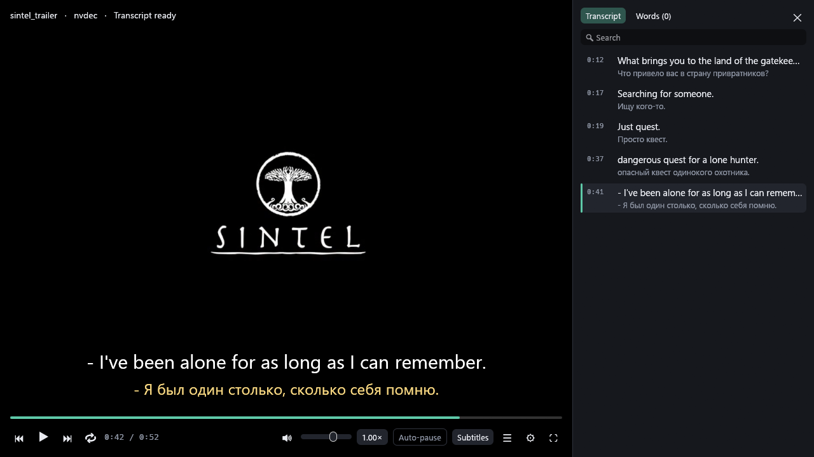

# LinguaPlay

[English](README.md) · [Русский](README.ru.md) · [Українська](README.uk.md) · **中文**

一款为“看视频学语言”的人设计的视频播放器。它同时显示原文台词和译文，能为没有字幕的视频自动生成字幕，
点击任意单词即可看到解释，并帮你保存想记住的单词。


## 功能

- **双语字幕。** 上面是原文，下面是译文。如果文件里有你的母语字幕轨，就直接使用；如果没有，
  播放器会在播放时提前翻译原文，台词说出来的时候译文已经准备好了。
- **语音生成字幕。** 完全没有字幕？Whisper 会在你的电脑上本地识别语音。在较新的 NVIDIA 显卡上，
  一小时的视频大约一分钟就能处理完，而且总是优先处理你正在看的位置。
- **点击单词。** 播放会暂停并显示翻译；如果你使用大语言模型做翻译，还会解释这个词
  *在这句话里* 的意思。日语和中文会被正确地分词。
- **自己的生词本。** 单词会连同所在句子和视频中的时间点一起保存。一键发送到 Anki，
  卡片里会带上画面截图和这句台词的音频片段。
- **练习工具。** 每句台词后自动暂停、重复当前台词、逐句跳转，视频旁边还有可搜索的文字稿。
- **几乎什么都能播。** 播放由 [mpv](https://mpv.io) 负责，FFmpeg 能打开的格式都支持：
  MKV、MP4、WebM、AVI、MOV、TS；H.264、HEVC、AV1、VP9 等，并支持硬件解码。
  在线视频通过 yt-dlp 播放。



## 当前状态

这是 0.1 版，第一个可以正常使用的版本。

| | |
|---|---|
| Windows 10/11 x64 | 已构建并经过人工测试（NVIDIA 显卡）。 |
| Linux、macOS | 可在 CI 中编译并通过测试。**目前还没有人在这两个系统上实际运行过界面**，欢迎反馈。 |

本版本的已知限制：

- 实时语音字幕需要显卡才能跟上播放速度。只用 CPU 时，Whisper 的速度和视频播放速度差不多，
  建议先让它处理完再看。
- 语音识别只支持本地文件，不支持在线视频。
- 在 Windows 上，只有 NVIDIA 显卡可以不复制画面地解码；其他显卡使用带复制的硬件解码
  （`d3d11va-copy`），4K 以内够用，但 CPU 占用更高。
- 图形字幕（蓝光 PGS、DVD）由 mpv 以图片形式显示，无法点击单词。
- ASS 字幕的样式不会还原，只显示文字。
- 界面语言为英文。

## 安装

### Windows

1. 从 [Releases](../../releases) 页面下载 `linguaplay-windows-x64.zip` 并解压。
2. 安装 FFmpeg（用于读取字幕轨和音频）：
   `winget install Gyan.FFmpeg`
3. 运行 `linguaplay.exe`，把视频拖进窗口。

可选：安装 [yt-dlp](https://github.com/yt-dlp/yt-dlp) 以播放在线视频（`winget install yt-dlp`）。

### Linux 和 macOS

从源码构建（见下文），并安装 mpv 库和 FFmpeg：

```sh
# Debian / Ubuntu
sudo apt install libmpv2 ffmpeg
# macOS
brew install mpv ffmpeg
```

## 配置附加功能

所有选项都在 **Settings**（齿轮按钮）里。只用普通的双语字幕不需要任何配置：
翻译默认通过 Google 翻译直接可用。

**翻译。** 选择一个服务：

| 服务 | 密钥 | 说明 |
|---|---|---|
| Google 翻译 | 不需要 | 默认选项。速度快，偏直译。 |
| DeepL | DeepL API 密钥 | 欧洲语言的译文更自然。 |
| OpenAI 兼容接口 | 视服务而定 | OpenAI，或通过 Ollama / LM Studio 运行的本地模型（`http://localhost:11434/v1`）。可结合上下文解释单词。 |
| Claude | Anthropic API 密钥 | 翻译时会参考前后台词。可结合上下文解释单词。 |

密钥保存在用户目录下的 `config.toml` 中。环境变量 `LINGUAPLAY_API_KEY` 的优先级更高。

**语音识别。** LinguaPlay 调用 [whisper.cpp](https://github.com/ggml-org/whisper.cpp)：

1. 下载包含 `whisper-server` 的 whisper.cpp 构建（Windows 上的 NVIDIA 显卡请使用 whisper.cpp
   发布页中的 `whisper-bin-win-cuda-12.4.0-x64.zip`）。
2. 下载模型，例如
   [`ggml-large-v3-turbo.bin`](https://huggingface.co/ggerganov/whisper.cpp/tree/main)。
   把 [`ggml-silero-v5.1.2.bin`](https://huggingface.co/ggml-org/whisper-vad/tree/main)
   放在同一个文件夹里，它能避免 Whisper 在静音和音乐处凭空生成文字。
3. 在 Settings → Speech recognition 中填写 `whisper-server` 和模型的路径。
4. 点击 **Subtitles → Transcribe speech**，或勾选“Transcribe automatically”。

识别结果会被缓存，每个视频只需识别一次。

**Anki。** 安装 [AnkiConnect](https://ankiweb.net/shared/info/2055492159) 插件并保持 Anki 运行。
牌组和“LinguaPlay”笔记类型会在第一次导出时自动创建。

## 快捷键

| 按键 | 功能 |
|---|---|
| `空格` | 播放 / 暂停 |
| `A` / `D` | 上一句 / 下一句 |
| `S` | 重复当前这一句 |
| `P` | 每句之后自动暂停 |
| `←` / `→` | 后退 / 前进 5 秒 |
| `↑` / `↓` | 音量 |
| `[` / `]` | 减速 / 加速 |
| `1` / `2` | 隐藏或显示原文 / 译文 |
| `T` | 文字稿和已保存的单词 |
| `F`、双击 | 全屏 |
| `M` | 静音 |
| `Ctrl+O` | 打开文件 |
| `Esc` | 关闭单词卡片、退出全屏 |

与视频放在一起的字幕文件（`Movie.srt`、`Movie.en.srt`、`Movie.zh.ass`）会被自动加载。
也可以直接把字幕文件拖进窗口。

## 从源码构建

需要 [Rust](https://rustup.rs) 1.88 或更高版本，以及一个 C 编译器。

```sh
git clone https://github.com/Magerko/linguaplay
cd linguaplay
cargo build --release
```

播放器在运行时加载 mpv 库，因此不需要链接任何东西：

- **Windows：** 运行 `scripts/fetch-mpv.ps1`，它会下载 `libmpv-2.dll` 并放到构建出的程序旁边。
  也可以自己从 [mpv 开发版构建](https://github.com/shinchiro/mpv-winbuild-cmake/releases) 中取出该 DLL。
- **Linux / macOS：** 会自动找到系统中的 `libmpv`。

运行测试：`cargo test --workspace`。播放器还可以用真实文件自检：

```sh
linguaplay --selftest video.mkv --subs en,zh --at 30
```

它会播放几秒钟，输出观察到的信息（画面尺寸、解码器、丢帧数、屏幕上的字幕），
如果有问题则以非零退出码结束。

## 实现方式

全部用 Rust 编写，分为五个 crate：

| Crate | 内容 |
|---|---|
| `lp-core` | 字幕解析（SRT、WebVTT、ASS）、分词、练习逻辑、配置。不做任何输入输出。 |
| `lp-store` | SQLite：翻译缓存、识别结果、已保存的单词。 |
| `lp-ai` | 翻译服务、Whisper 客户端、AnkiConnect。 |
| `lp-media` | 运行时加载的 libmpv 轻量绑定；以子进程方式调用 FFmpeg 和 whisper-server。 |
| `linguaplay` | 应用本体：基于 [egui](https://github.com/emilk/egui) 的界面，与 mpv 共用同一个 OpenGL 上下文。 |

mpv 在显卡上把每一帧渲染到纹理，egui 再把字幕画在上面，所以每个单词都是真正的界面元素，
可以悬停和点击，而且没有任何一帧需要经过 CPU 复制。网络和磁盘操作都在后台线程中进行，
界面线程从不等待。

## 致谢与许可

LinguaPlay 是自由软件，以 [GNU GPL v3](LICENSE) 或更高版本发布。

它建立在 [mpv](https://mpv.io) 和 [FFmpeg](https://ffmpeg.org)、
[whisper.cpp](https://github.com/ggml-org/whisper.cpp)、[egui](https://github.com/emilk/egui)、
[Lindera](https://github.com/lindera/lindera) 以及 [jieba-rs](https://github.com/messense/jieba-rs) 之上。
“围绕语言学习打造播放器”这一想法深受 [LLPlayer](https://github.com/umlx5h/LLPlayer) 的启发。

Windows 发布包中附带的 `libmpv-2.dll` 来自
[shinchiro 的 mpv 构建](https://github.com/shinchiro/mpv-winbuild-cmake)（GPL，源码可在该处获取）。

截图中的影片是 *Sintel* 预告片，© Blender Foundation，[durian.blender.org](https://durian.blender.org)，CC BY 3.0。
