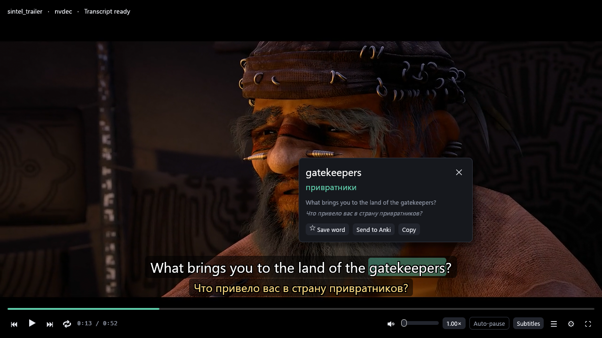
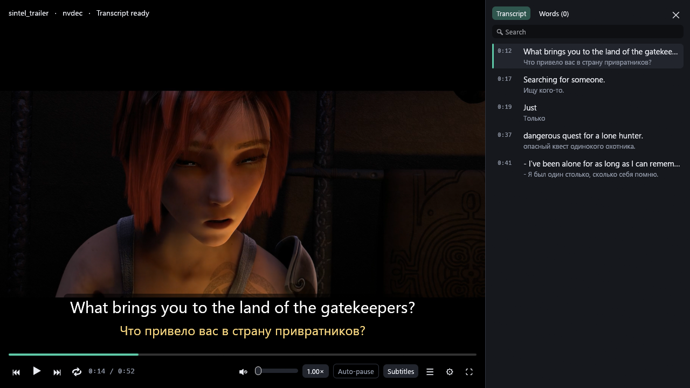

# Glossplay

[English](README.md) · [Русский](README.ru.md) · [Українська](README.uk.md) · **中文**

一款为“看视频学语言”的人设计的视频播放器。它同时显示原文台词和译文，能为没有字幕的视频自动生成字幕，
点击任意单词即可看到解释，并帮你保存想记住的单词。



## 功能

- **双语字幕。** 上面是原文，下面是译文。如果文件里有你的母语字幕轨，就直接使用；如果没有，
  播放器会在播放时提前翻译原文，台词说出来的时候译文已经准备好了。
- **语音生成字幕。** 完全没有字幕？Whisper 会在你的电脑上本地识别语音。只需点一个按钮即可安装：
  播放器会根据你的显卡选择合适的版本，并下载它和模型。在较新的 NVIDIA 显卡上，
  一小时的视频大约两分钟就能处理完，而且总是优先处理你正在看的位置。没有 NVIDIA 显卡时，
  会在处理器上用较小的模型运行，速度较慢：大约与视频播放速度相当。
- **点击单词。** 播放会暂停并显示翻译；如果你使用大语言模型做翻译，还会解释这个词
  *在这句话里* 的意思。日语和中文会被正确地分词。
- **自己的生词本。** 单词会连同所在句子和视频中的时间点一起保存。一键发送到 Anki，
  卡片里会带上画面截图和这句台词的音频片段。
- **练习工具。** 每句台词后自动暂停、重复当前台词、逐句跳转，视频旁边还有可搜索的文字稿。
- **译文配音。** 译文台词可以用语音念出来，叠加在被调低音量的原声之上；原声和配音的音量分别调节。
  语音引擎（OmniVoice，通过 audio.cpp 运行）在你点击后才会下载。配音默认关闭，需要显卡，
  且仅限非商业用途（模型权重采用 CC BY-NC 许可）。
- **几乎什么都能播。** 播放由 [mpv](https://mpv.io) 负责，FFmpeg 能打开的格式都支持：
  MKV、MP4、WebM、AVI、MOV、TS；H.264、HEVC、AV1、VP9 等，并支持硬件解码。
  粘贴在线视频的链接即可播放：Glossplay 会自动下载 yt-dlp 并保持其更新。首次启动时，播放器会把 yt-dlp（约 23 MB）下载到自己的数据文件夹。
- **界面语言**为英语、俄语和乌克兰语，可在设置中选择；默认跟随系统语言。



## 当前状态

这是 0.1 版，第一个可以正常使用的版本。

| | |
|---|---|
| Windows 10/11 x64 | 已构建并经过人工测试，环境为 Windows 11 和 NVIDIA 显卡。 |
| Linux、macOS | 代码可在 CI 中构建并通过测试。**目前还没有人在这两个系统上实际运行过界面**，欢迎反馈。语音识别和配音需要在那里手动配置：一键安装仅适用于 Windows。 |

本版本的已知限制：

- 没有显卡时，实时语音识别可能跟不上播放速度；只用处理器时，建议先让它处理完再看。
- 语音识别只支持本地文件，不支持在线视频。
- 配音只在 NVIDIA 显卡上试过。其 Vulkan 版本面向任意显卡，但尚未在 AMD 和 Intel 显卡上试过。
- 语音的质量取决于模型；只有一个词的台词（如“好。”“不。”）听起来可能不太自然。
- 在 Windows 上，只有 NVIDIA 显卡可以不复制画面地解码；其他显卡使用带复制的硬件解码
  （`d3d11va-copy`），4K 以内够用，但 CPU 占用更高。
- 图形字幕（蓝光 PGS、DVD）由 mpv 以图片形式显示，无法点击单词。
- ASS 字幕的样式不会还原，只显示文字。

## 安装

### Windows

1. 从 [Releases](../../releases) 页面下载 `glossplay-windows-x64.zip` 并解压。
2. 安装 FFmpeg（用于读取字幕轨和音频）：
   `winget install Gyan.FFmpeg`
3. 运行 `glossplay.exe`，把视频拖进窗口。

语音识别和配音需要 Microsoft Visual C++ Redistributable 2015–2022 (x64)。
大多数电脑上已经装有它。如果语音识别无法启动，请安装：
`winget install Microsoft.VCRedist.2015+.x64`

如需，可在设置中开启“在资源管理器的“打开方式”和右键菜单中显示 Glossplay”：它只对当前用户生效，不会把 Glossplay 设为默认播放器。在 Windows 11 中，该项位于“显示更多选项”里。

### Linux 和 macOS

从源码构建（见下文），并安装 mpv 库和 FFmpeg：

```sh
# Debian / Ubuntu
sudo apt install libmpv2 ffmpeg
# macOS
brew install mpv ffmpeg
```

## 配置附加功能

所有选项都在 **Settings**（齿轮按钮）里。只用普通的双语字幕不需要任何配置：
翻译默认通过 Google 翻译直接可用。

**翻译。** 选择一个服务：

| 服务 | 密钥 | 说明 |
|---|---|---|
| Google 翻译 | 不需要 | 默认选项。速度快，偏直译。 |
| DeepL | DeepL API 密钥 | 欧洲语言的译文更自然。 |
| OpenAI 兼容接口 | 视服务而定 | OpenAI，或通过 Ollama / LM Studio 运行的本地模型（`http://localhost:11434/v1`）。可结合上下文解释单词。 |
| Claude | Anthropic API 密钥 | 翻译时会参考前后台词。可结合上下文解释单词。 |

隐私：使用机器翻译时，字幕文本会发送给你选择的翻译服务；本地模型（Ollama / LM Studio）不会向互联网发送任何内容，语音识别则始终在本地进行。

密钥保存在用户目录下的 `config.toml` 中。环境变量 `GLOSSPLAY_DEEPL_API_KEY`、`GLOSSPLAY_OPENAI_API_KEY`、`GLOSSPLAY_ANTHROPIC_API_KEY`（各自仅对相应的服务商生效）的优先级更高。

**语音识别。** 选择 **Subtitles → Transcribe speech…**，或 **Settings → Speech recognition → Install**。
Glossplay 会检测你的显卡，并下载 [whisper.cpp](https://github.com/ggml-org/whisper.cpp)、
Whisper 模型和 Silero 语音检测器（它能避免 Whisper 在静音和音乐处凭空生成文字）：

| 你的电脑 | 安装内容 | 下载量 |
|---|---|---|
| NVIDIA 显卡，驱动 525 或更新 | NVIDIA 版本，模型 `large-v3-turbo` | 约 2.3 GB |
| 同上，但显存较小（低于约 3.8 GB） | NVIDIA 版本，模型 `large-v3-turbo-q5_0` | 约 1.3 GB |
| 没有 NVIDIA 显卡（或驱动过旧） | 处理器版本，模型 `small` | 约 500 MB |

下载前，对话框会显示确切大小，也可以自己选择版本和模型（`large-v3-turbo`、`large-v3-turbo-q5_0`、
`small` 或 `base`）。中断的下载会从断点继续。没有 NVIDIA 显卡时识别较慢——大约与视频播放速度相当——
所以请在观看前给它留出一点先行时间。第一次识别时，NVIDIA 版本可能需要最多一分钟来适配显卡
（在 RTX 50 系列上见到过）。使用 **Subtitles → Transcribe speech**，或勾选“Transcribe automatically”。
识别结果会被缓存，每个视频只需识别一次。

*高级：使用自己的 whisper.cpp。* 在 Settings → Speech recognition → Advanced 中，可以指定你自己的
`whisper-server` 和模型文件。需要包含 `whisper-server` 的 whisper.cpp 构建：最新的发布版本常常没有文件，
请打开[所有发布版本的列表](https://github.com/ggml-org/whisper.cpp/releases)，选择最新的、带有文件（Assets）
的版本，它的标签形如 `b5454`。Windows 上的 NVIDIA 显卡请下载 `whisper-bin-win-cuda-12.4.0-x64.zip`；
其他显卡或仅用处理器时，下载 `whisper-bin-x64.zip`。模型在 [Hugging Face](https://huggingface.co/ggerganov/whisper.cpp/tree/main)；
把 [`ggml-silero-v5.1.2.bin`](https://huggingface.co/ggml-org/whisper-vad/tree/main) 放在与模型相同的文件夹里。

**配音。** 通过 **Subtitles → Voice-over (dub the translation)** 开启，或在 Settings → Voice-over 中设置。
配音念的是译文，所以需要先显示译文。第一次使用时，Glossplay 会提示下载语音引擎：
GitHub 上的 audio.cpp（版本 v0.9.5）和 Hugging Face 上的 OmniVoice 模型（`omnivoice-q8_0`）。
语音在你的电脑上生成，不会向任何地方发送内容。

| 版本 | 下载量 |
|---|---|
| Vulkan——任意显卡（默认） | 约 1.44 GB |
| NVIDIA（CUDA）——稍快，但大得多 | 约 2.21 GB |

需要显卡：只用处理器时，语音生成比视频播放慢 6–10 倍，跟不上。配音使用“Translate into”所选的语言。
在 Subtitles 菜单中，两个滑块分别调节原声音量（默认 25%）和配音音量（100%）；
在显卡上第一次启动最多可能需要半分钟。

使用条款，下载前需要你接受：

- 仅限非商业用途。OmniVoice 模型采用 CC BY-NC 4.0 许可：模型本身及其生成的语音都不得用于商业目的。
- 不得使用语音引擎在未经本人同意的情况下模仿真实人物的声音。
- Built with Higgs Materials licensed from Boson AI USA, Inc.（模型内部的音频分词器，
  采用 Boson Higgs Audio 2 Community License 许可。）

*高级：使用自己的语音服务器。* 如果你已经运行了带有 OpenAI 兼容 `/v1/audio/speech` 接口的服务器，
请在 Settings → Voice-over → Advanced 中填写它的地址。该设置保存在 `config.toml` 的 `[tts]` 段中：
`base_url`（例如 `http://host:port/v1`；留空表示使用已安装的引擎）、`model`、`voice`（留空表示服务器默认声音）、
以百分比表示的 `original_volume` 和 `voice_volume`，以及 `enabled`（默认关闭）。

**Anki。** 安装 [AnkiConnect](https://ankiweb.net/shared/info/2055492159) 插件并保持 Anki 运行。
牌组和“Glossplay”笔记类型会在第一次导出时自动创建。

## 快捷键

| 按键 | 功能 |
|---|---|
| `空格` | 播放 / 暂停 |
| `A` / `D` | 上一句 / 下一句 |
| `S` | 重复当前这一句 |
| `P` | 每句之后自动暂停 |
| `←` / `→` | 后退 / 前进 5 秒 |
| `↑` / `↓` | 音量 |
| `[` / `]` | 减速 / 加速 |
| `1` / `2` | 隐藏或显示原文 / 译文 |
| `T` | 文字稿和已保存的单词 |
| `F`、双击 | 全屏 |
| `M` | 静音 |
| `Ctrl+O` | 打开文件 |
| `Esc` | 关闭单词卡片、退出全屏 |

与视频放在一起的字幕文件（`Movie.srt`、`Movie.en.srt`、`Movie.zh.ass`）会被自动加载。
也可以直接把字幕文件拖进窗口。

## 路线图

不承诺时间表，这只是大致方向。

- 把视频导出为文件，带有译文音轨、内嵌的单语或双语字幕，以及配音音轨。
- 影视剧目录，可从用户自己添加的来源直接播放。
- 在 AMD 和 Intel 显卡上加速语音识别。
- 在 Windows 的 AMD 和 Intel 显卡上实现不复制画面的播放。
- 经过验证的 Linux 和 macOS 构建与安装包。
- Yomitan 格式的词典，以及单词的词典原形。
- 用原说话人的声音配音——仅在声音所有者同意的前提下。
- 中文及其他界面语言。
- Windows 安装程序，以及 Windows 11 简短右键菜单中的入口。

## 从源码构建

需要 [Rust](https://rustup.rs) 1.95 或更高版本，以及一个 C 编译器。

```sh
git clone https://github.com/Magerko/glossplay
cd glossplay
cargo build --release
```

播放器在运行时加载 mpv 库，因此不需要链接任何东西：

- **Windows：** 运行 `scripts/fetch-mpv.ps1`，它会下载 `libmpv-2.dll` 并放到构建出的程序旁边。
  也可以自己从 [mpv 开发版构建](https://github.com/shinchiro/mpv-winbuild-cmake/releases) 中取出该 DLL。
- **Linux / macOS：** 会自动找到系统中的 `libmpv`。

要在 Windows 上构建用于分发的发布版，请使用 `scripts/build-release.ps1`：它会从 exe 中去除本机路径（主目录、用户名）。随后用 `scripts/package.ps1` 把 `glossplay.exe`、`libmpv-2.dll` 和许可证文件打包成 zip。

运行测试：`cargo test --workspace`。播放器还可以用真实文件自检：

```sh
glossplay --selftest video.mkv --subs en,zh --at 30
```

它会播放几秒钟，输出观察到的信息（画面尺寸、解码器、丢帧数、屏幕上的字幕），
如果有问题则以非零退出码结束。`glossplay --help` 会列出其他选项，
其中 `--install-asr`、`--install-tts` 和 `--asr-status` 可在命令行中安装和检查各组件。

## 实现方式

全部用 Rust 编写，分为五个 crate：

| Crate | 内容 |
|---|---|
| `gp-core` | 字幕解析（SRT、WebVTT、ASS）、分词、练习逻辑、配置。不做任何输入输出。 |
| `gp-store` | SQLite：翻译缓存、识别结果、已保存的单词。 |
| `gp-ai` | 翻译服务、Whisper 客户端、语音合成客户端、AnkiConnect。 |
| `gp-media` | 运行时加载的 libmpv 轻量绑定；以子进程方式调用 FFmpeg、whisper-server 和语音引擎。 |
| `glossplay` | 应用本体：基于 [egui](https://github.com/emilk/egui) 的界面，与 mpv 共用同一个 OpenGL 上下文。 |

mpv 在显卡上把每一帧渲染到纹理，egui 再把字幕画在上面，所以每个单词都是真正的界面元素，
可以悬停和点击，而且没有任何一帧需要经过 CPU 复制。网络请求、ffmpeg、语音识别和配音都在后台线程中运行，因此播放不会因它们工作而卡住。

## 致谢与许可

Glossplay 是自由软件，以 [GNU GPL v3](LICENSE) 或更高版本发布。

它建立在 [mpv](https://mpv.io) 和 [FFmpeg](https://ffmpeg.org)、
[whisper.cpp](https://github.com/ggml-org/whisper.cpp)、[egui](https://github.com/emilk/egui)、
[Lindera](https://github.com/lindera/lindera) 以及 [jieba-rs](https://github.com/messense/jieba-rs) 之上。
配音使用 [audio.cpp](https://github.com/0xShug0/audio.cpp)（Apache-2.0）和
[OmniVoice](https://github.com/k2-fsa/OmniVoice) 模型；模型不包含在发布包中，
由你自行下载，并适用其自身的条款（见上文）。
“围绕语言学习打造播放器”这一想法深受 [LLPlayer](https://github.com/umlx5h/LLPlayer) 的启发。

Windows 发布包中附带的 `libmpv-2.dll` 来自
[shinchiro 的 mpv 构建](https://github.com/shinchiro/mpv-winbuild-cmake)（GPL，源码可在该处获取）。
压缩包中还附有 `THIRD-PARTY.txt` 和 `THIRD-PARTY-RUST.txt`，列出所有第三方组件的版本、来源和许可证。

截图中的影片是 *Sintel* 预告片，© Blender Foundation，[durian.blender.org](https://durian.blender.org)，CC BY 3.0。
